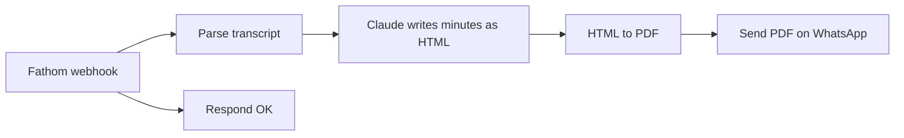

# Fathom Meeting Summary to WhatsApp

When a meeting recorded by Fathom ends, this workflow writes the minutes and sends them as a PDF to a WhatsApp chat. Nobody has to open the recording or write notes by hand.

## What the minutes contain

The prompt asks Claude for a fixed HTML structure, so every PDF has the same layout:

- **Key Takeaways**: decisions and highlights across the whole meeting
- **Team Updates**: one table row per speaker, with Completed, In Progress, Plan and Blockers
- **High Risks**: left out when the transcript mentions none
- **Action Items**: grouped by person, left out when there are none

Transcripts in Bangla, English or a mix of both are summarized in English. The prompt tells the model to use only what is in the transcript.

## Nodes

| Node | Role |
|---|---|
| Fathom Webhook | Receives the `POST` from Fathom at `/webhook/fathom-meeting` |
| Respond OK | Answers the webhook straight away so Fathom does not wait for the summary |
| Parse Transcript | Flattens the transcript into `Speaker: text` lines and reads the title and date |
| AI Summarize + AWS Bedrock Claude | Produces the minutes as raw HTML |
| HTML to PDF | Wraps the HTML in a print stylesheet and renders the PDF |
| Extract PDF as Base64 | Converts the binary PDF for the WhatsApp request |
| Send PDF to WhatsApp | Calls Evolution API `sendMedia` with the PDF as a document |

## Configuration

1. Set `EVOLUTION_URL`, `EVOLUTION_API_KEY`, `EVOLUTION_INSTANCE` and `WHATSAPP_RECIPIENT` in `.env`.
2. In n8n, create an **AWS** credential with Bedrock access and a **CustomJS** credential for the PDF node, then select them on the two nodes that need them.
3. In Fathom, add a webhook that points to `https://<your-n8n-host>/webhook/fathom-meeting` and include the transcript in the payload.
4. Activate the workflow.

## Adapting it

- **Language and layout**: edit the system prompt in `AI Summarize`. The section list and the HTML skeleton are both defined there.
- **Timezone**: `Parse Transcript` formats the date for `Asia/Dhaka`. Change the `timeZone` value.
- **Model**: change the model ID on `AWS Bedrock Claude`, or replace the node with another chat model.
- **Another source**: any tool that can post a transcript works. Only `Parse Transcript` reads the payload shape.
