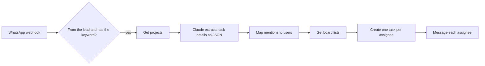

# WhatsApp Task Creation

A team lead writes a task in a WhatsApp group and mentions who should do it. This workflow creates the task in the project management tool and sends each assignee a direct message with the deadline and a link.

```
Lead, in the group:   task @Alice @Bob fix the checkout bug by Friday
Bot, to Alice:        Hi Alice, a new task has been assigned to you.
                      Task: Fix the checkout bug
                      Deadline: 2026-07-03
                      Project: web-shop
                      View: https://tasks.example.com/projects/web-shop?task=481
```



## How it works

1. **Filter.** Evolution API posts every group message to the webhook. The workflow continues only when the sender is the configured lead and the message contains the trigger keyword as a whole word.
2. **Extract.** Claude receives the message, the mentioned WhatsApp IDs, today's date and the list of projects. It returns JSON with the title, deadline, description, project and estimated hours. If no deadline is given, it uses the default number of days.
3. **Map.** WhatsApp mentions arrive as LIDs. A lookup table maps each LID to a name and a user ID in the task tool.
4. **Create.** The task is placed in the project's `In Progress` list, or in the fallback list when the project has none. One task is created per assignee.
5. **Notify.** Each assignee gets a direct message. Messages go out one at a time, 10 seconds apart.

Messages that the model does not classify as a task stop after step 2.

## Configuration

The workflow reads its settings from two **Global Constants** credentials (community node `n8n-nodes-globals`). Create both in n8n and name them `config` and `user-mapping`.

- `config`: paste the contents of [config.example.txt](config.example.txt) and fill in your values.
- `user-mapping`: paste [user-mapping.example.txt](user-mapping.example.txt) with one entry per team member.

| Constant | Purpose |
|---|---|
| `TASK_API_URL` | Base URL of the task tool's API |
| `TASK_API_TOKEN` | API key, sent as the `X-API-Key` header |
| `TASK_APP_URL` | Base URL of the task tool's web app, used for the link in the message |
| `LEAD_LID` | WhatsApp LID of the person allowed to create tasks |
| `TRIGGER_KEYWORD` | Word that marks a message as a task command |
| `DEFAULT_DEADLINE_DAYS` | Deadline when the message gives none |
| `PROJECT_ID` | Project used when the message does not match one |
| `LIST_ID` | List used when the project has no `In Progress` list |

Then:

1. Set `EVOLUTION_URL`, `EVOLUTION_API_KEY` and `EVOLUTION_INSTANCE` in `.env`.
2. Create an **AWS** credential with Bedrock access and select it on `AWS Bedrock Claude`.
3. Point your Evolution API instance at the workflow:

   ```bash
   curl -X POST "$EVOLUTION_URL/webhook/set/$EVOLUTION_INSTANCE" \
     -H "apikey: $EVOLUTION_API_KEY" \
     -H "Content-Type: application/json" \
     -d '{"webhook": {"url": "https://<your-n8n-host>/webhook/whatsapp-task", "events": ["MESSAGES_UPSERT"], "enabled": true}}'
   ```

4. Activate the workflow.

## Task API contract

The three HTTP nodes expect a small REST API. To connect another tool (Trello, ClickUp, Jira, your own backend), change the URLs and field names in those nodes.

| Node | Request | Expected response |
|---|---|---|
| Get Projects | `GET /projects` | `[{ "id": 1, "title": "Web Shop", "slug": "web-shop" }]` |
| Get Board Lists | `GET /projects/{id}/lists` | `[{ "id": 7, "title": "In Progress" }]` |
| Create Task | `POST /tasks` | `{ "id": 481 }` or `{ "task": { "id": 481 } }` |

Body sent to `POST /tasks`:

```json
{
  "title": "Fix the checkout bug",
  "description": "",
  "project_id": 1,
  "list_id": 7,
  "assignee_ids": [12],
  "start_date": "2026-07-01",
  "due_date": "2026-07-03",
  "estimated_hours": 24,
  "assignee_lid": "100000000000001@lid",
  "assignee_name": "Alice"
}
```

`assignee_lid` and `assignee_name` are there for the WhatsApp message. The API can ignore them.

The link in the message is built as `TASK_APP_URL/projects/{slug}?task={id}`. Change it in `Notify Assignee on WhatsApp` to match your tool's URLs.
